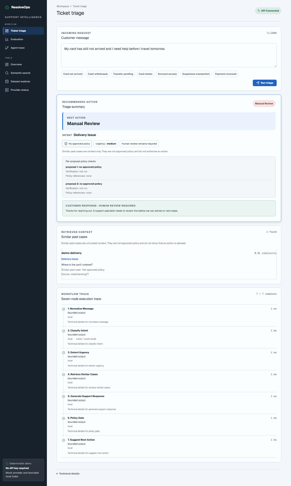
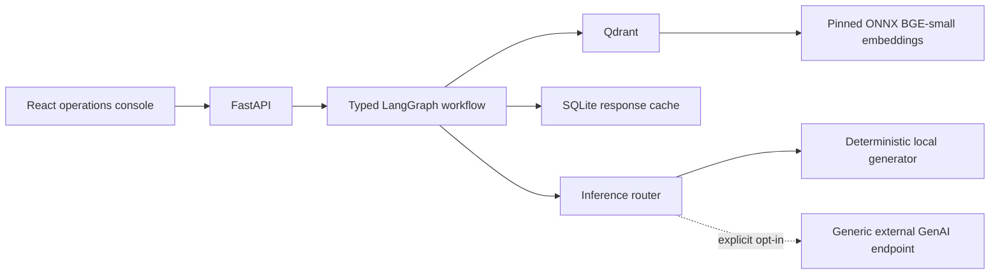

# Customer Support RAG Triage Agent

A typed, inspectable support-triage workflow that classifies intent and urgency, retrieves similar past cases for context, and requires an approved policy check before exposing a proposed action.

## Recruiter snapshot

**Signal:** Policy-aware triage boundaries with inspectable traces and explicit human review.

[Repository](https://github.com/Praciller/customer-support-rag-triage-agent) · [Existing live demo (pre-v2)](https://customer-support-rag-triage-agent.onrender.com/) · [Dream Logs case study](https://dreamlogsdata.com/en/projects/customer-support-rag-triage-agent)

**What this demonstrates:** typed workflow orchestration · similar-case retrieval kept separate from policy · deterministic checks with a human-review boundary.

**Boundary:** the existing Render deployment has not been updated to this change. This local source uses 27 synthetic records, pinned ONNX embeddings, deterministic mock generation, and no approved policy source. It is for portfolio review—not real customer support or production-quality inference. The older Hugging Face Space is a separate legacy build.

The live link is the previous deployment and does not show the current API v2 behavior. This local source has not been deployed.

## Evidence-backed outcomes

- Runs a fixed seven-node LangGraph workflow with typed state and an inspectable per-node trace.
- Retrieves bounded Banking77-derived similar cases from in-memory Qdrant with pinned ONNX BGE-small embeddings and stable, idempotent fixture IDs.
- Exposes inference mode, cache, fallback, degraded-mode, retrieval, policy review, and human-action metadata.
- Ships a zero-key deterministic review path plus a checked-in 8-ticket regression artifact. The fixture demonstrates reproducibility, not real-world model quality.
- Preserves an optional generic external GenAI route without coupling the public repository to a specific inference vendor.

[](https://github.com/Praciller/customer-support-rag-triage-agent/actions/workflows/ci.yml)


## Reviewer path

1. Start the local API and console using the quickstart below.
2. Run **Card not arrived** and inspect intent, urgency, no-approved-policy status, and human-review route.
3. Inspect the complete 7/7 trace and the deterministic evaluation fixture.
4. Review the architecture, evaluation methodology, and security boundaries.

The screenshot shows the current API v2 UI rendered with deterministic Playwright fixture data.
Similar past cases are context only; the interface shows that they are not approved policy. This
is not a live API response or a capture of the older deployment.



This is a reviewable support decision workflow with an explicit human-review boundary.

## Architecture



The local source bootstraps 27 bounded Banking77-derived records into Qdrant without duplicating stable IDs. They are labeled similar past cases and are never policy authority or evidence that an action is allowed. No approved policy source is configured, so generated proposals are withheld and the workflow returns a short acknowledgement with human review. Demo and mock modes require no external model account or credential.

## Workflow stages

1. `normalize_message`
2. `classify_intent`
3. `detect_urgency`
4. `retrieve_similar_cases`
5. `generate_support_response`
6. `policy_gate`
7. `suggest_next_action`

Each successful node records duration, bounded input/output summaries, component, inference metadata, cache/fallback/degraded flags, similar-case references, and policy review status. Similar past cases remain separate from workflow policy authority. Providers cannot mark their own output as policy-checked or cite a retrieved case to authorize an action. The default demo has no approved policy source; every generated proposal is withheld.

## Deterministic evaluation

The checked-in evaluation artifact was regenerated on November 14, 2026 with pinned ONNX `BAAI/bge-small-en-v1.5`, deterministic mock generation, 27 indexed demo cases, and 8 labeled synthetic evaluation tickets. It describes this source tree; it has not been deployed. Measured local latency is **not** a Render-hosted latency benchmark.

| Metric | Result |
| --- | ---: |
| Intent accuracy / macro F1 | 100.0% / 100.0% |
| Urgency accuracy | 100.0% |
| Precision@5 / Recall@5 | 37.5% / 62.5% |
| MRR / nDCG@5 | 0.771 / 0.611 |
| Zero-result rate | 0.0% |
| No-approved-policy cases | 8 / 8 |
| Manual-review routes | 8 / 8 |
| Proposals withheld | 10 / 10 |
| Workflow success rate | 100.0% |
| P50 / P95 local latency | 6.1 ms / 10.5 ms |

Recall and nDCG use the three known relevant fixture records per intent. Policy review results are structural counts only: they measure withheld proposals and manual-review routing. They do not prove semantic entailment or policy correctness. See the [generated summary](reports/evaluation/summary.md) and [methodology](docs/evaluation.md).

The public response contract is version 2.0. It removes `grounded`, grounding/confidence scores, and evidence/citation integrity claims. It adds `policy_status`, per-proposal `proposal_checks`, `verified_proposals`, and separately typed similar-case references. Clients built for the previous response schema must be updated. This change has not been deployed.

## Local quickstart

```powershell
python -m venv .venv
.venv\Scripts\Activate.ps1
python -m pip install -r requirements.txt
Copy-Item .env.example .env
uvicorn src.api.main:app --reload --port 8000
```

In another terminal:

```powershell
cd frontend
npm ci
npm run dev
```

Open `http://localhost:5173`. The first ONNX provider run downloads the pinned public Qdrant BGE model (384 dimensions). CI can use hashing embeddings for a network-free workflow check.

### Optional external GenAI route

The default remains local/mock. To activate external GenAI outside demo mode, configure a server-side endpoint that accepts the neutral JSON contract documented in [`docs/model_routing.md`](docs/model_routing.md):

```env
DEMO_MODE=false
MOCK_LLM_MODE=false
EXTERNAL_LLM_URL=https://your-server-side-endpoint.example/v1/generate
EXTERNAL_LLM_API_KEY=
EXTERNAL_LLM_MODEL=general
```

The browser never receives the endpoint credential. If the external route fails, the existing router can fall back to the deterministic local provider and marks fallback/degraded state in workflow metadata.

### Docker alternative

```powershell
docker compose up --build
```

- Console: `http://localhost:5173`
- API docs: `http://localhost:8000/docs`
- Readiness: `http://localhost:8000/ready`
- Qdrant: `http://localhost:6333/dashboard`

## Testing and verification

```powershell
.venv\Scripts\ruff.exe check src tests
.venv\Scripts\ruff.exe format --check src tests
.venv\Scripts\python.exe -m pytest

cd frontend
npm run lint
npm test
npm run build
npm run build-storybook
npm run test:e2e
```

CI builds Storybook and runs the Chromium browser and accessibility suites. The verified public demo is hosted on **Render** at GitHub SHA `a45a9abaae2881bbf14133f981c317206fa7e65c` ([post-merge 5/5 CI](https://github.com/Praciller/customer-support-rag-triage-agent/actions/runs/40120551076)); it serves a bounded zero-key fixture, not production support quality. The separate Hugging Face Space is still on legacy revision `a2661562ff1a2a7b7f15e4b9145cb007c98444a5` and is **not** the current recommended demo.

Reproduce the checked-in evaluation from the repository root:

```powershell
$env:DEMO_MODE="true"
$env:MOCK_LLM_MODE="true"
$env:QDRANT_MODE="memory"
$env:EMBEDDING_PROVIDER="onnx"
$env:LLM_CACHE_ENABLED="false"
.venv\Scripts\python.exe -m src.evaluation.evaluate_triage
```

Run the deterministic adversarial evidence-boundary evaluation and regenerate its fixed report:

```powershell
.venv\Scripts\python.exe -m src.evaluation.evaluate_adversarial_retrieval --report-path reports/evaluation/adversarial_retrieval.md
```

See the [adversarial retrieval report](reports/evaluation/adversarial_retrieval.md) for the committed fixture and measured invariant checks.

### Separate synthetic Thai policy slice

`data/eval/thai_policy_slice.json` is an independent, explicitly synthetic fixture for offline
Thai-language policy retrieval evaluation. Its `scope` and `permission` labels are fixture metadata
used to filter records before lexical scoring; they are not connected to user identity or production
authorization. The character-bigram baseline is deterministic and needs no model download or API.
It does not alter the English Banking77 demo, imply Thai embedding support, or establish policy
correctness. Positive retrieval, denied cross-scope access, missing-evidence abstention, and an
injection attempt are included with explicit denominators.

Run it with `python -m src.evaluation.evaluate_thai_policy --report-path reports/evaluation/thai_policy_slice.md`.
The existing optional external inference route is separate from this offline evaluation. See the
[Thai slice report](reports/evaluation/thai_policy_slice.md) for measured checks and a practical
upgrade roadmap.

## API review points

```powershell
curl.exe http://localhost:8000/health
curl.exe http://localhost:8000/ready
curl.exe -X POST http://localhost:8000/triage -H "Content-Type: application/json" -d '{"message":"My card has not arrived","top_k":5}'
curl.exe -X POST http://localhost:8000/search-similar -H "Content-Type: application/json" -d '{"message":"I need a refund","top_k":5}'
curl.exe http://localhost:8000/eval/results
```

`/provider-health` reports whether external inference is configured and active, along with cache, embedding, vector-store, and ingestion state. It never returns credentials or the configured external URL.

## Security and limitations

- Requests forbid extra fields and bound message length, `top_k`, and ingestion batch size.
- Public ingestion is disabled; non-local ingestion requires `X-Admin-API-Key`.
- External inference credentials stay server-side and are only used when demo/mock modes are explicitly disabled.
- Controlled errors omit stack traces, environment values, credentials, external endpoint URLs, and local paths.
- Retrieved records are untrusted similar-case context, not company policy. They are typed separately, never used as policy references, and cannot become system/developer/workflow instructions.
- Structural authority isolation: **tested** with workflow, provider-contract, API, and trace regression checks.
- Deterministic adversarial fixture: **tested** with eight synthetic records and a reproducible report; this checks structural authority isolation and fail-closed policy routing.
- Semantic LLM prompt-injection immunity: **NOT established**. The deterministic tests do not prove that a real language model will semantically ignore every malicious retrieved string.
- Draft responses require human review. Policy authority, tenant isolation, distributed rate limiting, and sensitive-data retention require controls beyond this demo.
- The in-memory limiter and local Qdrant/SQLite state are single-process constraints. Free CPU hosts may cold-start or exceed memory limits.

## Documentation

- [Architecture and node contracts](docs/architecture.md)
- [Deterministic demo mode](docs/demo_mode.md)
- [Inference routing](docs/model_routing.md)
- [Data source and license](docs/data_source.md)
- [Evaluation methodology](docs/evaluation.md)
- [Qdrant lifecycle](docs/qdrant.md)
- [Deployment](docs/deployment.md)
- [Free Render demo and dated ONNX evaluation](docs/render-free-onnx-demo-evaluation.md)
- [Outstanding Hugging Face release gates](https://github.com/Praciller/customer-support-rag-triage-agent/issues/89)
- [Security](docs/security.md)
- [Operations runbook](docs/runbook.md)
- [Portfolio review](PORTFOLIO_REVIEW.md)

## Resume bullet

Built a policy-gated support triage workflow with typed LangGraph orchestration, Qdrant similar-case retrieval, local BGE embeddings, structural evaluation, a vendor-neutral optional external GenAI adapter, cache/fallback controls, protected FastAPI endpoints, and a React policy-review console.
