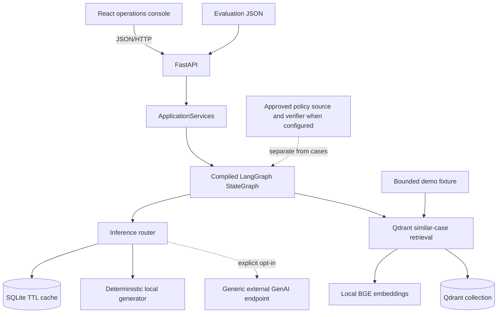

# Architecture

## Runtime boundaries

FastAPI owns trust-boundary validation, rate limits, ingestion authorization, controlled errors,
liveness, and readiness. `ApplicationServices` constructs inference routes, cache, retriever, and
graph. Demo/mock mode selects the deterministic local route. External GenAI requires explicit
non-demo configuration and remains server-side. The default demo has no approved policy source or
policy verifier configured.

## Workflow contract

`TriageState` carries the ticket, intent, urgency, similar past cases, candidate proposals,
per-proposal policy checks, verified proposals, policy status, next action, inference metadata,
and append-only trace through seven fixed nodes. Similar past cases and policy references are
separate data. Prompts remain in `prompts/`; inference and retrieval implementations remain
outside graph orchestration.

Every node returns bounded, non-secret trace metadata. Public responses exclude environment values,
external endpoint URLs, credentials, raw prompts, filesystem paths, and stack traces.

### Seven-node implementation contract

| Node | Typed state consumed | Typed state produced | Degraded or error behavior | Trace evidence |
| --- | --- | --- | --- | --- |
| `normalize_message` | `message`, `top_k` | `normalized_message` | API validation rejects empty or over-limit input before the graph. Unexpected errors become a controlled API 500. | Input and normalized lengths; local component. |
| `classify_intent` | `normalized_message` | `intent` | Unknown labels become `other`. No confidence score is returned. Degraded/fallback flags remain visible. | Intent, route, model label, cache/fallback/degraded flags. |
| `detect_urgency` | `normalized_message`, `intent` | `urgency`, `escalate`, `escalation_reason` | Unknown urgency becomes `medium`; high and critical urgency set the escalation flag. Intent and urgency remain visible when policy is unavailable. | Urgency, escalation flag, route, model label, cache/fallback/degraded flags. |
| `retrieve_similar_cases` | `normalized_message`, `intent`, `top_k` | public similar cases and `similar_case_references` | A missing collection returns no cases. If intent-filtered retrieval returns nothing, a single unfiltered lookup is attempted. Retrieved text is untrusted context and never policy authority. | Intent filter, requested K, returned count, similar-case IDs, Qdrant component. |
| `generate_support_response` | current ticket, intent, urgency | candidate proposals and fixed safe acknowledgement | Retrieved cases are not passed as policy evidence. Provider fields such as `grounded`, confidence, or citations are ignored. Malformed or degraded output is withheld. | Candidate count only, route/model label and cache/fallback/degraded flags. |
| `policy_gate` | candidate proposals, approved policy IDs, host-provided verifier outcome | per-proposal checks, verified proposals, `policy_status` | Every proposal needs its own approved policy reference and a passing check. Missing policy, unsupported/conflicting/uncertain results, invalid references, verifier errors, or degraded generation fail closed. This gate is structural and does not prove semantic entailment. | Policy status, check count, approved policy IDs only. |
| `suggest_next_action` | policy status, verified proposals, intent, urgency, escalation | `next_action` | Without verified proposals the action is `manual_review`. A verified high/critical case routes to `escalate_to_human`; other verified cases may use `reply_to_customer`. | Inputs used and selected action; rules component. |

`TriageState` is a `TypedDict`, provider requests are typed dataclasses, API requests and
responses are Pydantic models, and the frontend mirrors the public trace, similar-case,
policy-check, and verified-proposal schemas in TypeScript. API version 2.0 removes the previous
grounding, confidence, and citation-integrity fields. A node that raises does not fabricate a
completed trace step; FastAPI returns a sanitized error instead.

## External inference boundary

The external adapter accepts only the bounded task payload assembled by the backend. It does not
receive browser credentials or direct control over retrieval, ingestion, policy approval,
next-action policy, or persistence. External generation output is only a candidate; a separate
policy gate must check it against an approved source before it can be shown as an allowed proposal.
The default demo configures no approved policy source or verifier. If the route fails, the router
can fall back to deterministic generation, and proposals from degraded generation are withheld.

## Data lifecycle

On startup, demo mode reads `data/demo/support_cases.json`, computes stable UUID5 point IDs,
retrieves existing IDs, and embeds/uploads only missing records. Readiness becomes `ready` only
when all fixture records exist. The full Banking77 dataset is never downloaded during demo startup
or CI.

## Deployment shapes

- Docker Compose: React dev server, FastAPI, and Qdrant server.
- Canonical CPU container (`Dockerfile.hf` and the Hugging Face release bundle): built React assets
  served by FastAPI, embedded local Qdrant, SQLite cache, and pinned ONNX embeddings on one
  application port. The older `deploy/huggingface/Dockerfile` remains a legacy FastEmbed recipe.
- Test/CI: in-memory Qdrant and deterministic hashing embeddings for bounded checks.
- Optional external GenAI: a separately controlled server-side endpoint behind the neutral
  adapter; not used by the default demo or checked-in deterministic evaluation.

Local embedded storage and the in-memory limiter are deliberate single-instance constraints. Move
to managed persistence and shared rate limiting only when horizontal scale is required.
